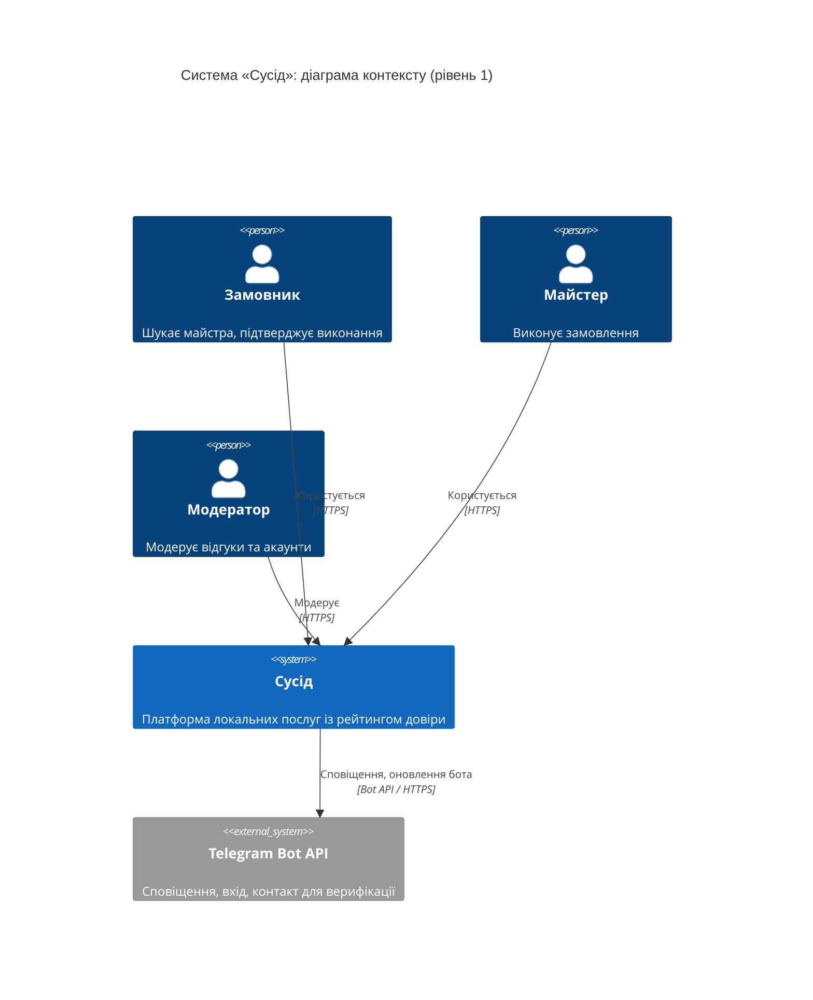
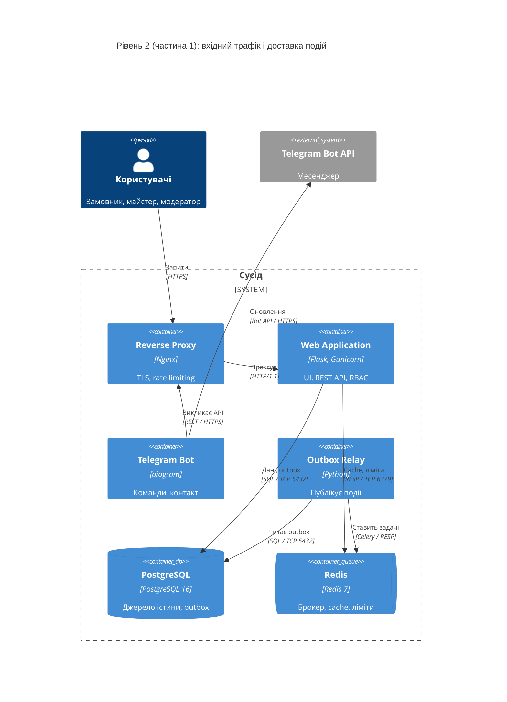
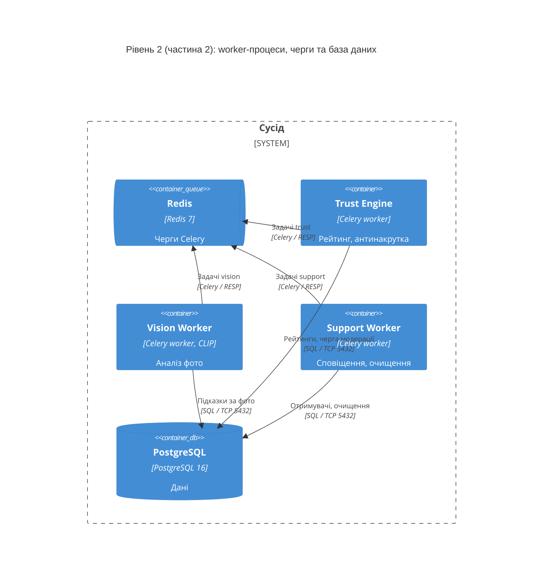
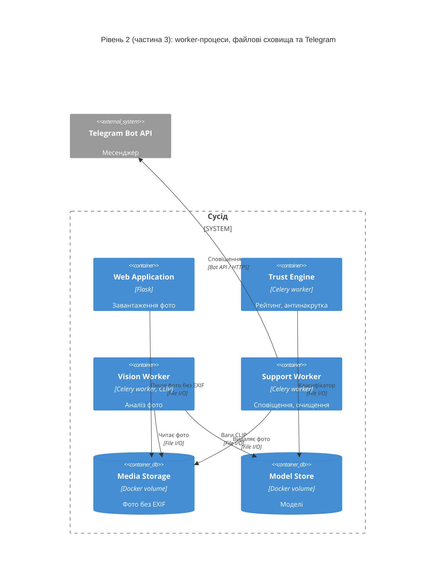
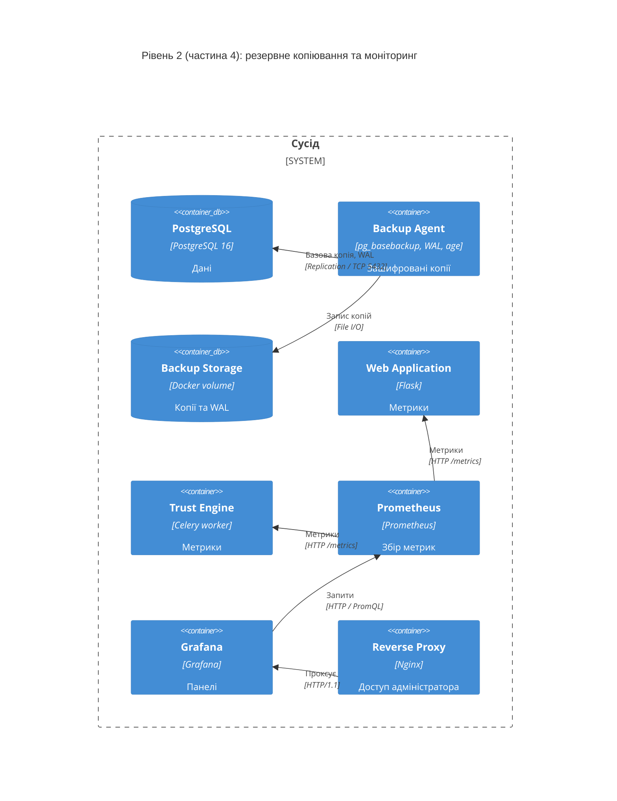

# Розділ 2. Проєктування архітектури системи

Документ описує архітектуру «Сусіда» за моделлю C4 (рівні Context, Container, Component) у форматі Diagrams-as-Code (Mermaid). Вимоги наведено у [srs.md](./srs.md), архітектурне рішення щодо доставки подій у [ADR-001](./adr/0001-choice-of-technology.md).

- [2.1. C4 Level 1: System Context](#c4-level-1-system-context)
- [2.1. C4 Level 2: Container](#c4-level-2-container)
- [2.2. C4 Level 3: Component (Trust Engine)](#c4-level-3-component-trust-engine)
- [2.3. Архітектурні рішення (ADR)](#23-архітектурні-рішення-adr)
- [Матриця трасування вимог на контейнери](#матриця-трасування-вимог-на-контейнери)

## 2.1. Контекстне та контейнерне моделювання системи (C4 Model)

## C4 Level 1: System Context

### Опис діаграми рівня 1

| Елемент | Тип | Призначення | Вимоги |
|---|---|---|---|
| Замовник | Person | Створює запити, підтверджує виконання, залишає відгуки | [SRS-FUN-11](./srs.md#srs-fun-11), [SRS-FUN-17](./srs.md#srs-fun-17) |
| Майстер | Person | Веде профіль, змінює статус замовлення, отримує підказку | [SRS-FUN-07](./srs.md#srs-fun-07), [SRS-FUN-39](./srs.md#srs-fun-39) |
| Модератор | Person | Перевіряє документи, чергу підозрілих відгуків, блокує акаунти | [SRS-FUN-06](./srs.md#srs-fun-06), [SRS-FUN-32](./srs.md#srs-fun-32) |
| Сусід | System | Предмет проєктування | [srs.md, розділ 1](./srs.md#1-system-context-контекст-системи) |
| Telegram Bot API | System_Ext | Зовнішній сервіс доставки сповіщень і верифікації контакту | [SRS-FUN-02](./srs.md#srs-fun-02), [SRS-FUN-05](./srs.md#srs-fun-05), [SRS-FUN-36](./srs.md#srs-fun-36) |

| Зв'язок | Протокол | Примітка |
|---|---|---|
| Користувачі → Сусід | HTTPS (TLS 1.2+) | [SRS-NFR-SEC-04](./srs.md#srs-nfr-sec-04) |
| Сусід → Telegram | Bot API / HTTPS | Вихідні виклики; ізоляція відмов [SRS-NFR-REL-03](./srs.md#srs-nfr-rel-03) |

Користувачі отримують сповіщення та передають контакт через клієнт Telegram (протокол MTProto); цей обмін відбувається поза межами системи, тому на діаграмі не показаний.

## C4 Level 2: Container

Діаграму контейнерів розділено на чотири вигляди за відповідальністю, щоб підписи зв'язків залишалися читабельними. Усі вигляди описують одну й ту саму систему; контейнери з'являються у кількох виглядах із тими самими назвами. Збір метрик Prometheus показано для Web Application і Trust Engine; Outbox Relay і Vision Worker експортують метрики за тим самим протоколом (HTTP GET /metrics).

### Частина 1. Вхідний трафік і доставка подій

### Частина 2. Worker-процеси, черги та база даних

### Частина 3. Worker-процеси, файлові сховища та Telegram

### Частина 4. Резервне копіювання та моніторинг

### Опис контейнерів рівня 2

| Контейнер | Технологія | Відповідальність | Вимоги |
|---|---|---|---|
| Reverse Proxy | Nginx | TLS-термінація, rate limiting, статичні файли | [SRS-NFR-SEC-04](./srs.md#srs-nfr-sec-04), [SRS-NFR-SEC-05](./srs.md#srs-nfr-sec-05) |
| Web Application | Flask, Gunicorn, Jinja2, HTMX | Автентифікація, RBAC, профілі, каталог, автомат замовлень, відгуки, паспорт рейтингу, модерація, запис outbox, видалення EXIF | [SRS-FUN-01…04](./srs.md#srs-fun-01), [SRS-FUN-06…20](./srs.md#srs-fun-06), [SRS-FUN-25](./srs.md#srs-fun-25), [SRS-FUN-32](./srs.md#srs-fun-32), [SRS-FUN-33](./srs.md#srs-fun-33), [SRS-FUN-37](./srs.md#srs-fun-37), [SRS-FUN-40](./srs.md#srs-fun-40), [SRS-FUN-41](./srs.md#srs-fun-41), [SRS-NFR-SEC-01…03](./srs.md#srs-nfr-sec-01) |
| Outbox Relay | Python | Публікація подій, повторна публікація необроблених | [SRS-FUN-34](./srs.md#srs-fun-34), [SRS-NFR-ASYNC-01](./srs.md#srs-nfr-async-01), [SRS-NFR-ASYNC-05](./srs.md#srs-nfr-async-05), [ADR-001](./adr/0001-choice-of-technology.md) |
| Trust Engine | Celery worker, networkx, scikit-learn | Рейтинг довіри та виявлення накруток (деталізовано на рівні 3) | [SRS-FUN-21…24](./srs.md#srs-fun-21), [SRS-FUN-26…31](./srs.md#srs-fun-26), [SRS-NFR-ASYNC-02](./srs.md#srs-nfr-async-02), [SRS-NFR-ALG-01](./srs.md#srs-nfr-alg-01) |
| Vision Worker | Celery worker, CLIP | Діагностика за фото | [SRS-FUN-38](./srs.md#srs-fun-38), [SRS-FUN-39](./srs.md#srs-fun-39), [SRS-NFR-ASYNC-03](./srs.md#srs-nfr-async-03), [SRS-NFR-ALG-02](./srs.md#srs-nfr-alg-02) |
| Support Worker | Celery worker | Сповіщення в Telegram, очищення за строками зберігання | [SRS-FUN-35](./srs.md#srs-fun-35), [SRS-FUN-36](./srs.md#srs-fun-36), [SRS-NFR-COMP-01](./srs.md#srs-nfr-comp-01), [SRS-NFR-COMP-02](./srs.md#srs-nfr-comp-02) |
| Telegram Bot | aiogram | Верифікація телефону за контактом, прив'язка акаунта | [SRS-FUN-05](./srs.md#srs-fun-05) |
| PostgreSQL | PostgreSQL 16, pg_trgm | Дані, обмеження цілісності, outbox, пошук | [SRS-FUN-09](./srs.md#srs-fun-09), [SRS-FUN-12](./srs.md#srs-fun-12), [SRS-FUN-17](./srs.md#srs-fun-17), [SRS-FUN-18](./srs.md#srs-fun-18), [SRS-FUN-33](./srs.md#srs-fun-33) |
| Redis | Redis 7 | Брокер Celery, cache, rate limiting | [SRS-NFR-PERF-01](./srs.md#srs-nfr-perf-01), [SRS-NFR-SEC-05](./srs.md#srs-nfr-sec-05), [ADR-001](./adr/0001-choice-of-technology.md) |
| Media Storage | Docker volume | Фотографії без EXIF | [SRS-FUN-07](./srs.md#srs-fun-07), [SRS-FUN-11](./srs.md#srs-fun-11) |
| Model Store | Docker volume | Ваги моделей та класифікатор | [SRS-FUN-29](./srs.md#srs-fun-29), [SRS-FUN-38](./srs.md#srs-fun-38) |
| Backup Agent, Backup Storage | pg_basebackup, WAL, age | Резервне копіювання та відновлення | [SRS-NFR-REL-01](./srs.md#srs-nfr-rel-01) |
| Prometheus, Grafana | Prometheus, Grafana | Метрики та сповіщення | [SRS-NFR-OBS-01](./srs.md#srs-nfr-obs-01) |

Контейнери є окремо розгортуваними процесами або сховищами Docker Compose. Внутрішні модулі Web Application (auth, catalog, orders, reviews, moderation) є компонентами модульного моноліту й на рівні 2 не виділяються.

Рішення, пов'язані з відмовостійкістю: окремі черги й worker-процеси для Trust Engine, Vision Worker і Support Worker обмежують вплив збою одного типу задач на інші; бот і Web Application взаємодіють лише через REST API; доставка подій забезпечується таблицею outbox, а не Redis ([ADR-001](./adr/0001-choice-of-technology.md)).

## 2.2. Компонентне моделювання критичного сервісу системи

## C4 Level 3: Component (Trust Engine)

Обрано контейнер **Trust Engine**, оскільки він містить основне обчислювальне й алгоритмічне навантаження: рейтинг довіри, ознаки графа, векторні подання текстів і класифікатор накруток.

```mermaid
C4Component
  title Trust Engine: діаграма компонентів (рівень 3)

  ContainerQueue(redis, "Redis", "Redis 7", "Брокер Celery")
  ContainerDb(db, "PostgreSQL", "PostgreSQL 16", "Дані системи")
  ContainerDb(models, "Model Store", "Docker volume", "Модель векторів, класифікатор")

  Container_Boundary(trust, "Trust Engine (Celery worker)") {
    Component(consumer, "Domain Event Consumer", "Celery task", "Приймає задачу trust і керує обробкою")
    Component(integrity, "Message Integrity Guard", "HMAC-SHA256", "Перевіряє підпис повідомлення з черги")
    Component(validator, "Payload Validator", "Pydantic", "Перевіряє схему та версію події")
    Component(idem, "Idempotency Guard", "SQL, UNIQUE event_id", "Відкидає вже оброблені події")
    Component(errh, "Error Handler and Retry Policy", "Celery autoretry", "Повтор з exponential backoff, після N спроб запис у dead_letter")
    Component(telemetry, "Telemetry", "prometheus_client, JSON logging", "Метрики та журнал із request_id")

    Component(ratingUC, "RecalculateRating UseCase", "Python service", "Оркеструє завантаження відгуків, розрахунок і збереження знімка")
    Component(fraudUC, "ScanReview UseCase", "Python service", "Оркеструє ознаки, оцінку підозрілості й чергу модерації")

    Component(calc, "Rating Calculator", "Чиста функція Python", "Формула R: байєсівське згладжування, вага за районом, затухання, бонус")
    Component(penalty, "Penalty Policy", "Чиста функція Python", "Відображає оцінку підозрілості в штраф P за порогом")
    Component(featx, "Graph Feature Extractor", "networkx", "Взаємність, кластеризація, частота відгуків")
    Component(textsim, "Text Similarity Scorer", "numpy", "Косинусна схожість векторів відгуків")
    Component(clf, "Fraud Classifier", "scikit-learn", "Оцінка підозрілості в діапазоні від 0 до 1")

    Component(pReview, "ReviewPort", "Python Protocol", "Читання відгуків і запис оцінки підозрілості")
    Component(pSnap, "RatingSnapshotPort", "Python Protocol", "Запис знімка рейтингу")
    Component(pQueue, "ModerationQueuePort", "Python Protocol", "Додавання елемента в чергу модератора")
    Component(pEmb, "EmbeddingPort", "Python Protocol", "Отримання вектора тексту")
    Component(pModel, "ModelStorePort", "Python Protocol", "Завантаження класифікатора")

    Component(aReview, "SQL Review Repository", "SQLAlchemy", "Реалізує ReviewPort")
    Component(aSnap, "SQL Rating Snapshot Repository", "SQLAlchemy", "Реалізує RatingSnapshotPort")
    Component(aQueue, "SQL Moderation Queue Repository", "SQLAlchemy", "Реалізує ModerationQueuePort")
    Component(aEmb, "Local Embedding Adapter", "sentence-transformers", "Реалізує EmbeddingPort")
    Component(aModel, "File Model Store", "joblib", "Реалізує ModelStorePort")
  }

  Rel(consumer, redis, "Споживає задачі", "Celery / RESP, TCP 6379")
  Rel(consumer, integrity, "Перевіряє підпис", "Виклик функції, middleware")
  Rel(consumer, validator, "Валідує payload", "Виклик функції, middleware")
  Rel(consumer, idem, "Перевіряє event_id", "Виклик функції, middleware")
  Rel(consumer, errh, "Передає виняток", "Celery on_failure, обробник")
  Rel(consumer, telemetry, "Записує метрики та журнал", "Виклик функції")
  Rel(consumer, ratingUC, "Запускає сценарій", "Виклик через інтерфейс UseCase, DI")
  Rel(consumer, fraudUC, "Запускає сценарій", "Виклик через інтерфейс UseCase, DI")

  Rel(ratingUC, pReview, "Читає відгуки", "Dependency Injection, Protocol")
  Rel(ratingUC, calc, "Обчислює R", "Виклик чистої функції")
  Rel(ratingUC, penalty, "Визначає штраф P", "Виклик чистої функції")
  Rel(ratingUC, pSnap, "Зберігає знімок рейтингу", "Dependency Injection, Protocol")

  Rel(fraudUC, pReview, "Читає граф взаємодій, пише оцінку", "Dependency Injection, Protocol")
  Rel(fraudUC, featx, "Обчислює ознаки графа", "Виклик компонента")
  Rel(fraudUC, textsim, "Обчислює схожість текстів", "Виклик компонента")
  Rel(fraudUC, clf, "Обчислює оцінку підозрілості", "Виклик компонента")
  Rel(fraudUC, pQueue, "Додає елемент у чергу модератора", "Dependency Injection, Protocol")

  Rel(textsim, pEmb, "Отримує вектори", "Dependency Injection, Protocol")
  Rel(clf, pModel, "Завантажує модель", "Dependency Injection, Protocol")

  Rel(aReview, pReview, "Реалізує", "Python Protocol, інверсія залежностей")
  Rel(aSnap, pSnap, "Реалізує", "Python Protocol, інверсія залежностей")
  Rel(aQueue, pQueue, "Реалізує", "Python Protocol, інверсія залежностей")
  Rel(aEmb, pEmb, "Реалізує", "Python Protocol, інверсія залежностей")
  Rel(aModel, pModel, "Реалізує", "Python Protocol, інверсія залежностей")

  Rel(aReview, db, "Запити до відгуків і замовлень", "SQL / TCP 5432")
  Rel(aSnap, db, "Запис знімків рейтингу", "SQL / TCP 5432")
  Rel(aQueue, db, "Запис у чергу модерації", "SQL / TCP 5432")
  Rel(aEmb, models, "Завантажує модель векторів", "POSIX file I/O")
  Rel(aModel, models, "Завантажує класифікатор", "POSIX file I/O")

  UpdateLayoutConfig($c4ShapeInRow="4", $c4BoundaryInRow="1")
```

### Опис компонентів рівня 3

| Шар | Компонент | Роль | Вимоги |
|---|---|---|---|
| Inbound | Domain Event Consumer | Точка входу: приймає задачу з черги, викликає захисні компоненти й сценарій | [SRS-FUN-26](./srs.md#srs-fun-26), [SRS-NFR-ASYNC-02](./srs.md#srs-nfr-async-02) |
| Захист | Message Integrity Guard | Перевіряє HMAC-SHA256 підпис повідомлення; відхиляє підроблені задачі за компрометації Redis | [SRS-NFR-SEC-08](./srs.md#srs-nfr-sec-08) |
| Захист | Payload Validator | Перевіряє схему та версію події до виконання логіки | [SRS-NFR-SEC-07](./srs.md#srs-nfr-sec-07) |
| Надійність | Idempotency Guard | Відкидає повторно доставлену подію за унікальним `event_id` | [SRS-FUN-35](./srs.md#srs-fun-35), [SRS-NFR-ASYNC-05](./srs.md#srs-nfr-async-05) |
| Надійність | Error Handler and Retry Policy | Повтор із експоненційною затримкою, після N невдач запис у `dead_letter` | [SRS-NFR-ASYNC-05](./srs.md#srs-nfr-async-05), [SRS-NFR-REL-04](./srs.md#srs-nfr-rel-04) |
| Спостережуваність | Telemetry | Метрики Prometheus і структуровані журнали з `request_id` | [SRS-NFR-OBS-01](./srs.md#srs-nfr-obs-01), [SRS-NFR-OBS-02](./srs.md#srs-nfr-obs-02) |
| Application | RecalculateRating UseCase | Сценарій перерахунку рейтингу майстра; залежить лише від портів і чистих функцій | [SRS-FUN-21](./srs.md#srs-fun-21), [SRS-FUN-25](./srs.md#srs-fun-25) |
| Application | ScanReview UseCase | Сценарій перевірки відгуку на накрутку | [SRS-FUN-27](./srs.md#srs-fun-27), [SRS-FUN-31](./srs.md#srs-fun-31) |
| Domain | Rating Calculator | Формула R без доступу до СУБД та мережі | [SRS-FUN-21…24](./srs.md#srs-fun-21) |
| Domain | Penalty Policy | Правило штрафу P за порогом θ | [SRS-FUN-30](./srs.md#srs-fun-30) |
| Domain | Graph Feature Extractor | Ознаки графа взаємодій | [SRS-FUN-27](./srs.md#srs-fun-27), [SRS-FUN-28](./srs.md#srs-fun-28) |
| Domain | Text Similarity Scorer | Схожість текстів за векторами | [SRS-FUN-28](./srs.md#srs-fun-28), [SRS-NFR-ASYNC-04](./srs.md#srs-nfr-async-04) |
| Domain | Fraud Classifier | Оцінка підозрілості | [SRS-FUN-29](./srs.md#srs-fun-29), [SRS-NFR-ALG-01](./srs.md#srs-nfr-alg-01) |
| Ports | ReviewPort, RatingSnapshotPort, ModerationQueuePort, EmbeddingPort, ModelStorePort | Інтерфейси (Python Protocol) між ядром і інфраструктурою | Принцип інверсії залежностей |
| Outbound | SQL Review / Rating Snapshot / Moderation Queue Repository | Реалізації портів через SQLAlchemy | [SRS-FUN-17](./srs.md#srs-fun-17), [SRS-FUN-31](./srs.md#srs-fun-31) |
| Outbound | Local Embedding Adapter, File Model Store | Локальні відкриті моделі, без зовнішніх API | [SRS-NFR-SEC-06](./srs.md#srs-nfr-sec-06) |

**Правила залежностей.** Domain не імпортує інфраструктурні пакети (SQLAlchemy, Celery). Application залежить від Domain і портів. Outbound-адаптери залежать від портів і реалізують їх. Inbound-компонент залежить від Application. Пряме звернення компонента Inbound або Domain до PostgreSQL заборонене; доступ до даних виконується лише через порти.

**Межа безпеки.** Автентифікація користувачів (JWT) і перевірка ролей (RBAC) виконуються в Web Application ([SRS-FUN-03](./srs.md#srs-fun-03), [SRS-FUN-04](./srs.md#srs-fun-04)). Trust Engine приймає лише задачі з валідним HMAC-підписом, що зменшує наслідки несанкціонованого запису в Redis. Знімок рейтингу читає Web Application із PostgreSQL, тому зворотного виклику Trust Engine не потрібно.

## 2.3. Архітектурні рішення (ADR)

| Номер | Назва | Статус |
|---|---|---|
| [ADR-001](./adr/0001-choice-of-technology.md) | Transactional Outbox у PostgreSQL + Celery + Redis замість RabbitMQ та Kafka | Approved |

## Матриця трасування вимог на контейнери

| Група вимог | Контейнери |
|---|---|
| [SRS-FUN-01…06](./srs.md#srs-fun-01) | Web Application, Telegram Bot, PostgreSQL |
| [SRS-FUN-07…16](./srs.md#srs-fun-07) | Web Application, PostgreSQL, Media Storage, Redis |
| [SRS-FUN-17…20](./srs.md#srs-fun-17) | Web Application, PostgreSQL |
| [SRS-FUN-21…31](./srs.md#srs-fun-21) | Trust Engine, PostgreSQL, Model Store |
| [SRS-FUN-33…36](./srs.md#srs-fun-33) | Web Application, Outbox Relay, Redis, Support Worker, Telegram Bot API |
| [SRS-FUN-37…40](./srs.md#srs-fun-37) | Web Application, Vision Worker, Media Storage, Model Store |
| [SRS-NFR-PERF-01…05](./srs.md#srs-nfr-perf-01) | Reverse Proxy, Web Application, Redis, PostgreSQL |
| [SRS-NFR-SEC-01…10](./srs.md#srs-nfr-sec-01) | Reverse Proxy, Web Application, Trust Engine |
| [SRS-NFR-REL-01…04](./srs.md#srs-nfr-rel-01) | Backup Agent, Backup Storage, Redis, Outbox Relay |
| [SRS-NFR-OBS-01…02](./srs.md#srs-nfr-obs-01) | Prometheus, Grafana, усі контейнери застосунку |
